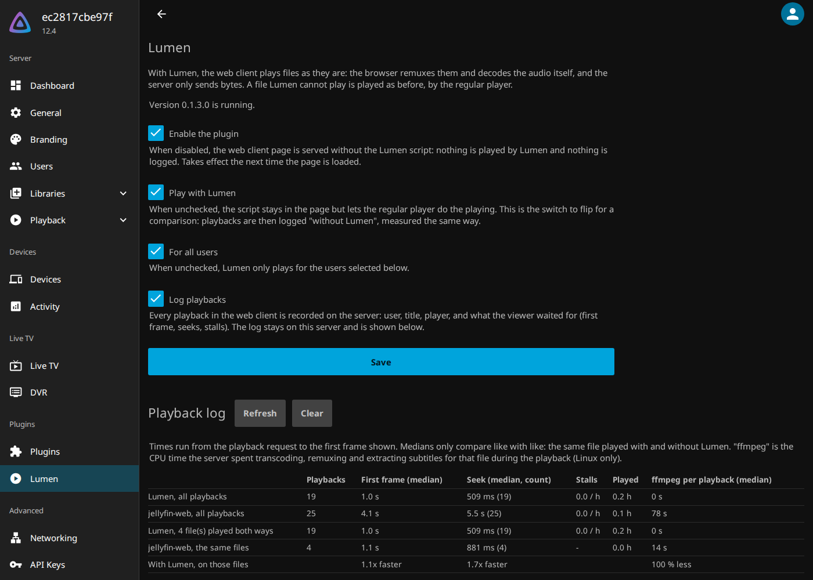

# Lumen for Jellyfin

Most libraries are MKV. Browsers play MP4. So nearly every time the Jellyfin web client plays an MKV, the server
has to run ffmpeg, even when the browser could decode the video and the audio as they are. The file only needed
a different container.

Lumen does that part in the browser. The server sends the file as it is, by byte ranges, and the browser
repackages it on the fly for its own `<video>` element. Audio the browser cannot play is decoded in the browser
as well. The server stops working for most of what you play:

- **Playback starts sooner**, because nothing waits for ffmpeg to start.
- **Seeking is faster**, because there is no stream to restart on the server.
- **The server's CPU stays idle**, since it only serves bytes.

A file Lumen cannot play is handed back to the regular Jellyfin player, with the reason logged. Playback is never
worse than without the plugin.



## Small on purpose

Lumen changes the container and nothing else. It has no video decoder, no renderer and no player interface of
its own, and it does not need WebGPU. The picture is decoded and displayed by the browser's own `<video>`
element, exactly as in a direct play, so hardware decoding and HDR output remain the browser's business. The
plugin archive weighs 1.3 MB, most of it audio decoders that are only loaded when a file needs them.

## How it works

1. The web client asks Lumen whether it can play the file. Lumen opens it over HTTP range requests, reads the
   container header and index, and checks each track against what this browser can decode.
2. If it can, the server is asked for the raw file and never starts ffmpeg.
3. Lumen reads the Matroska or MP4 container and rewrites the samples into fragmented MP4, fed to the
   `<video>` element through Media Source Extensions. Video samples are copied byte for byte.
4. Audio the browser can play is copied too. Audio it cannot play is decoded by FFmpeg decoders compiled to
   WebAssembly, in a worker, then re-encoded to AAC or Opus with the browser's own `AudioEncoder`.
5. A seek reads the container index and fetches the bytes at the target.

If Lumen cannot play the file, or fails while playing it, the web client negotiates with the server as usual and
its regular player takes over, transcoding included, at the same position.

## What it can play

A file plays through Lumen when the browser can decode its video codec and Lumen can carry its container and
audio. Lumen never decodes video.

| | Played through Lumen | Handed back to the regular player |
|---|---|---|
| Containers | Matroska (MKV), MP4 including fragmented MP4 | everything else (AVI, MPEG-TS, DVD and Blu-ray folders, ISO), live TV |
| Video, if the browser decodes it | H.264, HEVC 8-bit and 10-bit, AV1 | VP8, VP9, MPEG-2, MPEG-4 ASP, VC-1 |
| HDR | HDR10, and Dolby Vision with a base layer, passed to the browser and the display unchanged | Dolby Vision profile 5 (no base layer), Dolby Vision over AV1 |
| Audio copied as it is | AAC, Opus, FLAC, and AC-3 or E-AC-3 where the browser plays them | |
| Audio decoded in the browser, then re-encoded | TrueHD and MLP, DTS and DTS-HD, AC-3, E-AC-3, multichannel 24-bit FLAC, PCM | MP2 |

What happens to a given file depends on the browser. Safari plays AC-3, E-AC-3 and HEVC natively, so Lumen
copies everything. Chrome plays none of the Dolby audio formats, so Lumen decodes them. A browser without an
HEVC decoder gets the regular player for HEVC files.

Good to know:

- **HDR is not converted.** Lumen does no tone mapping. If you rely on the server to tone map HDR for an SDR
  screen, those files should keep going through the server.
- **Multichannel audio** that had to be decoded stays multichannel after re-encoding. On Apple devices, 7.1 is
  folded to 5.1. For Atmos and DTS:X, the channel bed is decoded and the objects are not rendered.
- **Audio that starts after the picture** is padded with silence, so playback starts on the first frame.
- **Changing the audio track** reopens the stream on the new track at the current position.
- **Subtitles** are the web client's own, fetched from the server as usual. Text subtitles are aligned with the
  picture; ASS and image subtitles (PGS) are drawn by the web client's own renderers and can lead the picture by
  about 0.2 s.
- **Quality settings** are respected. Lumen always reads the file at its original bitrate, so if you cap the
  bitrate below the file's, the regular player takes over.

## What stays Jellyfin

Lumen is a regular player of the Jellyfin web client. It extends the built-in video player and replaces only its
source. The player interface, subtitles, track menus, resume position, playback reporting and the Playback Info
panel are the web client's own. Playback Info names the player that is actually playing and, when it is Lumen,
shows what it does with the file.

On the server, the plugin does no media processing. It serves the player's files, adds one script tag to the web
client page and one entry to its `config.json` as they are served, and keeps its settings. It modifies no file
on disk, needs no other plugin, and works alongside plugins that modify the same page (File Transformation,
JavaScript Injector, themes). Disabling it gives you back the stock web client.

## Install

In Jellyfin, open Dashboard > Plugins > Repositories > New Repository and add:

```
https://raw.githubusercontent.com/LK59/lumen/main/manifest.json
```

Then install **Lumen** from the catalog, restart Jellyfin, and reload the web client.

- **Jellyfin 10.10 or later.**
- The web client must be opened over **HTTPS** or on `localhost`: browsers only expose the audio encoder in a
  secure context.
- If your reverse proxy sets a Content Security Policy, decoding audio needs `worker-src blob:` and
  `script-src 'wasm-unsafe-eval'`. Without them Lumen still plays the files whose audio it can copy and hands
  the others back.

To update, open the Lumen page: it shows the running version and the latest one, with a button that installs it
and restarts Jellyfin.

## Settings

Dashboard > Lumen:

- **Enable the plugin**: when off, the web client is served untouched.
- **Play with Lumen**: when off, the regular player does the playing while playbacks can still be logged. Flip it
  to compare playback with and without Lumen.
- **For all users**, or only the users you select.
- **Log playbacks** (off by default): records each playback on your server, with what the viewer waited for
  (first frame, each seek, stalls) and the CPU time ffmpeg spent on the server for that file. On files played both
  ways, the page shows how many times faster one player is than the other. The log stays on your server.

The browser console also says what Lumen is doing (`[Lumen] ...`), including why it declined a file.

## Limits and status

- Lumen acts only in the Jellyfin web client. Native apps with their own player are not affected.
- Tested with Chromium and Firefox on desktop. Safari and the mobile apps have not been tried yet.
- It relies on the internals of the web client's video player, which has no public extension interface. If a
  future version of the web client can no longer be extended this way, Lumen turns itself off and says so in the
  console, and the web client plays as it does without the plugin.
- During a network outage Lumen waits for the network to come back for up to 48 seconds, then reports a playback
  error to the web client.

## Source

| Folder | Contents |
|---|---|
| [`lumen-core/`](lumen-core/README.md) | The playback engine (TypeScript). It knows nothing about Jellyfin: a URL that honours `Range` in, a playing `<video>` out. Containers, remux, Media Source handling, audio decoding and re-encoding, with its test suite |
| [`plugin/web/`](plugin/README.md) | The bridge that makes the engine a Jellyfin web player (TypeScript) |
| [`plugin/server/`](plugin/README.md) | The Jellyfin plugin (C#) |
| [`docs/`](docs/pont-jellyfin-web.md) | How the bridge fits into the Jellyfin web client |
| `tools/test-jellyfin.sh` | A disposable Jellyfin for the browser tests |
| `manifest.json`, `releases/` | The plugin repository that Jellyfin reads |

Everything builds and runs through Docker; nothing is installed on the host. `plugin/package.sh` builds the
engine, the bridge and the plugin, and produces the plugin folder and its archive. The code comments and the
developer documentation are in French.

## Licenses

Lumen is the playback engine of [Laterna](https://github.com/LK59/laterna), released under AGPL-3.0.

The plugin archive includes audio decoders built from FFmpeg 7.1.5 (LGPL) compiled to WebAssembly, and libFLAC
(BSD) through `@wasm-audio-decoders/flac` (MIT). The scripts that build the FFmpeg decoders are in the Laterna
repository, under `tools/truehd-wasm`, `tools/ac3dts-wasm` and `tools/aac-wasm`.
